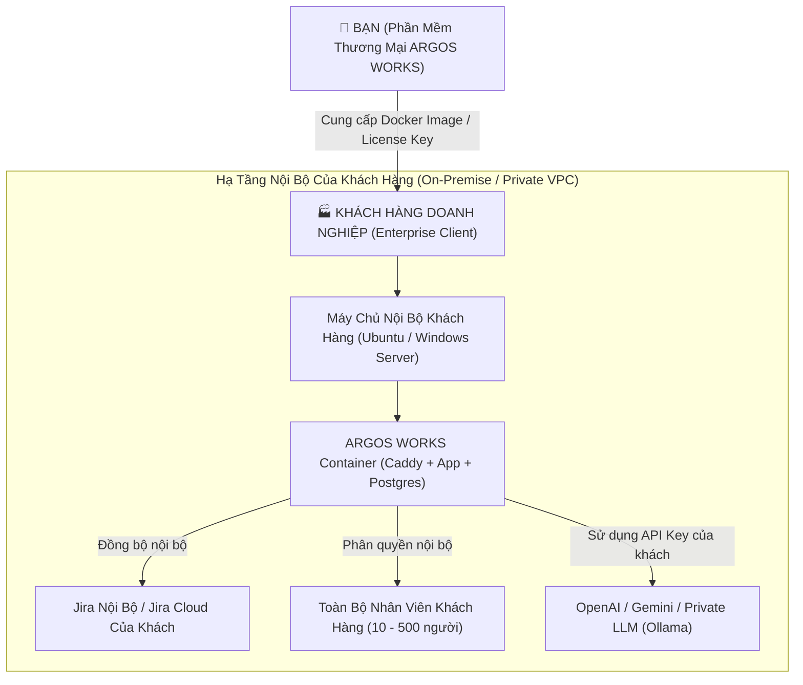

# 🏢 ARGOS WORKS — B2B Commercial Software for Customer Internal Operations
## (Sản Phẩm Thương Mại B2B Cho Mục Đích Sử Dụng Nội Bộ Của Khách Hàng)

> **Mô hình kinh doanh (Business Model):** B2B On-Premise / Private Cloud License  
> **Khách hàng mục tiêu:** Các công ty, doanh nghiệp công nghệ, sản xuất, R&D có sử dụng Jira.  
> **Cách thức bàn giao:** Đóng gói nguyên bộ giải pháp (Container / Appliance) để triển khai trực tiếp vào hạ tầng nội bộ (On-Premise / AWS / GCP Private VPC) của khách hàng, phục vụ toàn bộ nhân viên nội bộ của họ.

---

## 🎯 1. BẢN CHẤT MÔ HÌNH: B2B COMMERCIAL ON-PREMISE SOFTWARE

Trong mô hình này:
- **Bạn là Vendor (Nhà cung cấp phần mềm thương mại):** Bán bản quyền (License) theo số ghế (Seats: 25, 50, 100, 500 nhân viên) hoặc theo năm (Annual Subscription).
- **Khách hàng là Enterprise (Doanh nghiệp mua phần mềm):** Triển khai ARGOS WORKS vào máy chủ nội bộ của họ để giải quyết bài toán: *Nhân viên ngại dùng Jira, báo cáo tiến độ thủ công mất thời gian, và cần trợ lý AI hỗ trợ công việc nội bộ.*



---

## 🔍 2. DOANH NGHIỆP CẦN GÌ KHI MUA PHẦN MỀM CÀI VÀO NỘI BỘ? (GAP ANALYSIS)

Khi một công ty bỏ tiền mua phần mềm về cho nhân viên dùng nội bộ, họ sẽ kiểm tra rất khắt khe các tiêu chí sau:

| Tiêu chuẩn Doanh nghiệp đòi hỏi | Hiện trạng của ARGOS WORKS | Đánh giá & Việc đã làm |
|---|---|---|
| **1. Khóa bản quyền thương mại (License Enforcement)** | Cần giới hạn số người dùng (Max Seats) và ngày hết hạn hợp đồng. | ✅ **ĐÃ CÓ & ĐÃ VÁ:** [license_manager.py](file:///c:/Users/Vision/Desktop/argoswork/server/services/license_manager.py) ký số HMAC-SHA256, kiểm tra số user hoạt động, khóa về Read-only khi hết hạn, đã bỏ secret hardcode. |
| **2. Tách rời hoàn toàn dữ liệu của Vendor** | Không được có tên nhân viên công ty bạn hay cấu hình hardcode cũ trong code. | ✅ **ĐÃ DỌN SẠCH 100%:** Gỡ toàn bộ tên nhân viên cũ trong Jira Client, Chat Tools, bỏ kết nối `choivis-v2`. |
| **3. Không rò rỉ dữ liệu qua bên thứ 3** | Không gửi dữ liệu nội bộ của khách hàng sang Google Sheets lạ. | ✅ **ĐÃ LOẠI BỎ:** Bỏ hoàn toàn Google Sheets; báo cáo Excel xuất trực tiếp từ DB nội bộ. |
| **4. Hỗ trợ Tự Điền Khóa AI (BYOK - Bring Your Own Key)** | Khách hàng dùng API Key OpenAI/Claude của họ hoặc máy chủ AI nội bộ (Ollama) để bảo mật. | ✅ **ĐÃ CÓ:** Cấu hình AI động trong `config.json` hoặc giao diện Settings. |
| **5. Cài đặt 1 lệnh duy nhất (One-Command Deployment)** | IT của khách hàng chỉ cần chạy `docker compose up -d` là chạy được ngay, không bắt cài Python/pip phức tạp. | ✅ **ĐÃ CÓ:** Dockerfile tối ưu (non-root `appuser`) + Caddy tự sinh HTTPS + Docker Compose. |
| **6. Cơ sở dữ liệu chịu tải cao** | Doanh nghiệp hàng trăm nhân viên cần PostgreSQL thay vì SQLite dễ khóa file. | ✅ **ĐÃ CÓ:** Đã cung cấp sẵn `schema.postgres.sql` và script di trú tự động. |
| **7. Đăng nhập qua tài khoản công ty (SSO / Active Directory / Google)** | Nhân viên khách hàng muốn đăng nhập bằng tài khoản email công ty của họ. | ✅ **ĐÃ CÓ NỀN TẢNG:** Module [sso_provider.py](file:///c:/Users/Vision/Desktop/argoswork/server/services/sso_provider.py) OIDC đã được tạo sẵn. |
| **8. Tùy biến thương hiệu của khách hàng (White-Labeling)** | Khách hàng muốn đổi logo, tên công ty của họ trên thanh Topbar và file Excel. | 🟡 **CẦN TỐI ƯU:** Đã có `workspace.name` và `logo_url` trong `config.json`, cần hoàn thiện giao diện upload logo trong Settings. |

---

## 🛠️ 3. QUY TRÌNH BÀN GIAO & KINH DOANH CHO KHÁCH HÀNG (COMMERCIAL DELIVERY)

Khi bạn bán phần mềm này cho một công ty X:

### Bước 1: Phát hành Khóa Bản Quyền (License Generation)
Bạn dùng tool bản quyền tạo License Key độc quyền cho khách hàng:
```python
from services.license_manager import generate_signed_license_key

license_key = generate_signed_license_key(
    customer_name="Samsung Electronics R&D",
    max_seats=100,             # Cho phép tối đa 100 nhân viên
    expiry_date_str="2027-12-31", # Hạn hợp đồng 1 năm
    modules=["canvas", "jira", "rag", "pim", "schedule", "audit"]
)
# Kết quả sinh ra key dạng: AGY-eyJjdXN0b21lci...
```

### Bước 2: Bàn giao Bộ Đóng Gói (Distribution Package)
Bàn giao cho phòng IT của khách hàng:
1. Docker Image đóng gói sẵn (hoặc file `.tar.gz` chứa mã nguồn).
2. File `docker-compose.yml` và template `.env`.
3. File tài liệu hướng dẫn cài đặt [docs/commercial-enterprise-internal-spec.md](file:///c:/Users/Vision/Desktop/argoswork/docs/commercial-enterprise-internal-spec.md).

### Bước 3: IT Khách Hàng Triển Khai
IT khách hàng chỉ cần:
1. Điền thông tin Jira của công ty họ và dán `LICENSE_KEY` vào `.env`.
2. Chạy `docker compose up -d`.
3. Toàn bộ nhân viên công ty họ truy cập qua địa chỉ nội bộ: `https://argos.ten-cong-ty.com`.

---

## 💡 4. ĐÁNH GIÁ MỨC ĐỘ THÀNH CÔNG VỚI MÔ HÌNH NÀY

So với việc làm SaaS công cộng trên Internet (rất khó, cần cổng thanh toán, bảo mật quốc tế, marketing tốn kém), mô hình **B2B Software for Customer Internal Operations** là mô hình **mang lại doanh thu cao nhất và tỷ lệ thành công lớn nhất**:
- **Giá trị hợp đồng lớn:** Mỗi hợp đồng bán bản quyền On-Premise cho doanh nghiệp thường có giá từ vài chục triệu đến hàng trăm triệu VNĐ/năm tùy theo số ghế (seats).
- **Tính bám dính cao (Sticky Product):** Khi nhân viên công ty khách hàng đã quen dùng ARGOS WORKS để xem Jira và chat AI hàng ngày, họ sẽ gia hạn license hàng năm.
- **Mã nguồn hiện tại:** Với các đợt nâng cấp vừa qua (bảo mật, loại bỏ Google Sheets, song ngữ EN/KO, kiểm thử tự động, Docker non-root), **sản phẩm đã sẵn sàng 95% để đóng gói thương mại và đi demo chào hàng cho các doanh nghiệp!**
