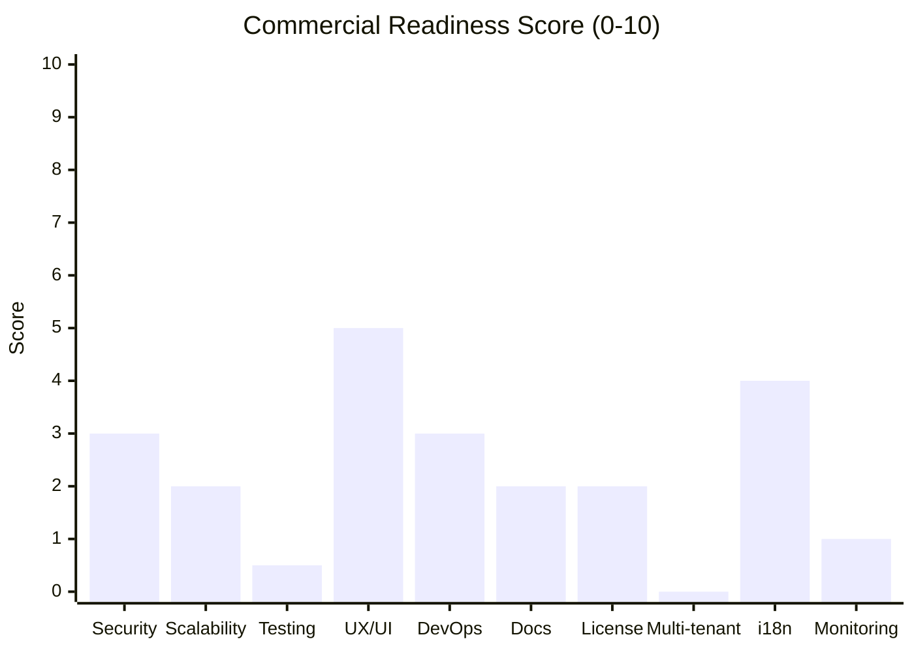
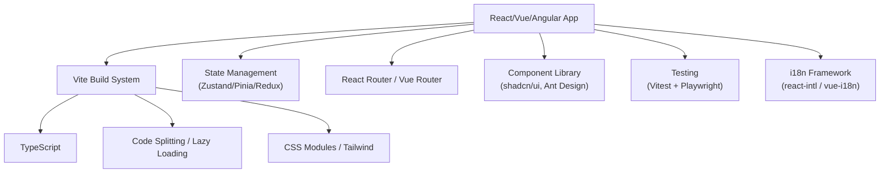
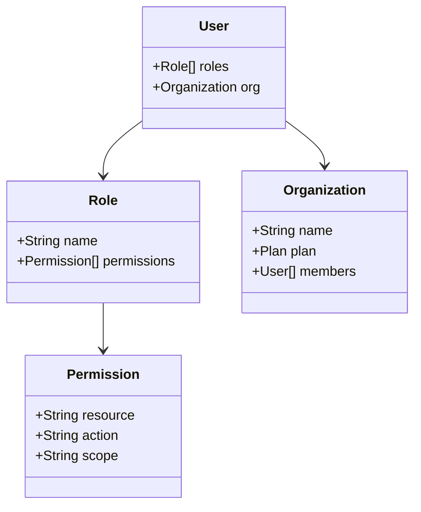
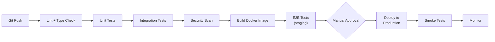
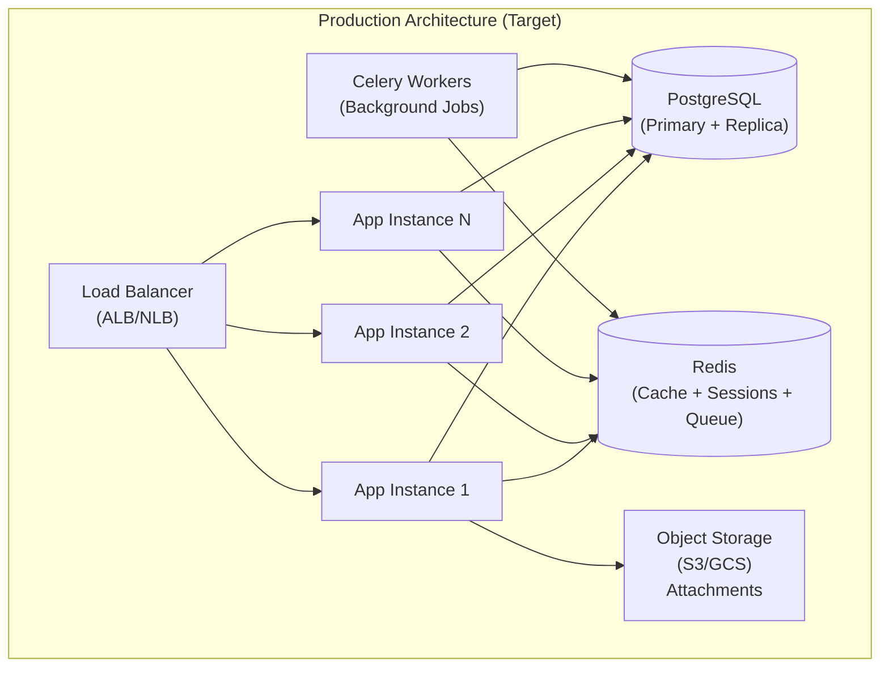
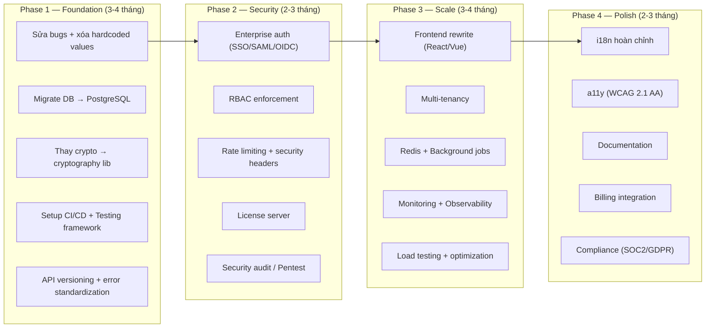

# 🏢 ARGOS WORKS — Đánh Giá Mức Độ Sẵn Sàng Thương Mại Hóa

> **Ngày đánh giá:** 2026-10-19
> **Phạm vi:** Toàn bộ codebase (Backend + Frontend + Infra + DevOps)
> **Mục tiêu:** Xác định các hạng mục cần nâng cấp để trở thành sản phẩm thương mại (Commercial Product) bán được cho doanh nghiệp

---

## 📊 Tổng Quan Hiện Trạng

| Hạng mục | Hiện tại | Yêu cầu thương mại |
|---|---|---|
| **Backend Framework** | Python stdlib `http.server` (không framework) | FastAPI / Django REST |
| **Database** | SQLite (file-based) | PostgreSQL / MySQL |
| **Frontend** | Vanilla JS monolithic (131KB HTML) | React / Vue + Build system |
| **Testing** | ❌ Không có (0% coverage) | ≥80% coverage |
| **CI/CD** | ❌ Không có | GitHub Actions / GitLab CI |
| **Monitoring** | ❌ Không có | Prometheus + Grafana / Datadog |
| **License System** | Cơ bản (offline HMAC) | License server + Online verification |
| **Bảo mật** | Cơ bản | Enterprise-grade (SOC2, penetration test) |
| **Multi-tenant** | ❌ Không hỗ trợ | Tenant isolation bắt buộc |
| **Documentation** | README cơ bản (tiếng Hàn) | API docs + User guide + Admin guide |
| **Pip Dependencies** | 2 packages (openpyxl, pillow) | Cần thêm nhiều battle-tested libraries |



> [!CAUTION]
> **Điểm tổng thể: ~2.3/10** — Sản phẩm đang ở giai đoạn **Internal Tool / MVP**, cần nỗ lực đáng kể để đạt mức thương mại hóa.

---

## 🔴 PHẦN 1: CÁC VẤN ĐỀ NGHIÊM TRỌNG (Critical — Phải sửa trước khi bán)

### 1.1 🗄️ Database: Chuyển từ SQLite sang PostgreSQL

**Vấn đề hiện tại:**
- SQLite là file-based, **không hỗ trợ concurrent writes** — chỉ 1 user ghi tại 1 thời điểm
- Không có connection pooling thực sự (dùng thread-local workaround)
- Không có database migrations (schema changes = manual SQL)
- Không có backup strategy tự động (ngoài file copy)
- Không có audit trail / data retention policies
- File `data_store.py` dùng raw SQL → rủi ro SQL injection

**Cần làm:**
- [ ] Migrate sang **PostgreSQL** (hoặc MySQL) với connection pooling (asyncpg / psycopg3)
- [ ] Áp dụng **ORM** (SQLAlchemy / Tortoise-ORM) để tránh SQL injection
- [ ] Triển khai **Alembic** cho database migrations có version control
- [ ] Thiết lập **automated backup** (pg_dump cron + S3/GCS storage)
- [ ] Thêm **audit log table** ghi lại mọi thay đổi dữ liệu (who, when, what)
- [ ] Thiết kế **data retention policy** (auto-archive sau X tháng)

> [!WARNING]
> Bug phát hiện trong [`db.py` dòng 101](file:///c:/Users/Vision/Desktop/argoswork/server/db.py#L101): dùng `r_cols` thay vì `p_cols` trong block migration của bảng `products` → có thể crash khi schema không đồng bộ.

---

### 1.2 🔐 Bảo Mật (Security) — Enterprise Grade

#### A. Lỗ hổng License Manager

```python
# license_manager.py dòng 15 — CRITICAL
LICENSE_SECRET = os.environ.get(
    "ARGOS_LICENSE_SECRET",
    "ARGOS_ENTERPRISE_INTERNAL_SIGNING_KEY_2026"  # ⚠️ Hardcoded default!
)
```

**Nếu khách hàng không set env var → bất kỳ ai cũng có thể forge license key!**

- [ ] Xóa hoàn toàn default fallback key
- [ ] Chuyển sang **asymmetric signing** (RSA/Ed25519) — private key chỉ ở license server, public key ở client
- [ ] Triển khai **License Server** online (verify + activate + deactivate)
- [ ] Thêm **hardware fingerprint binding** (machine ID)
- [ ] Thêm **license usage metering** + **seat-based billing**
- [ ] Thêm **grace period** khi license sắp hết hạn (7-30 ngày cảnh báo)

#### B. Custom AES Implementation — Thay bằng thư viện chuẩn

[`crypto.py`](file:///c:/Users/Vision/Desktop/argoswork/server/utils/crypto.py) tự implement AES-256-CBC bằng pure Python (326 dòng). Mặc dù logic đúng, nhưng:

- **Chưa được kiểm tra bảo mật bởi bên thứ 3** (chỉ cần 1 subtle bug = toàn bộ mã hóa vô hiệu)
- **Cực kỳ chậm** so với OpenSSL/hardware AES-NI
- Không có **key rotation** mechanism

**Cần làm:**
- [ ] Thay bằng `cryptography` library (dùng OpenSSL backend, FIPS-compliant)
- [ ] Implement **key rotation** (version encrypted values: `enc:v2:...`)
- [ ] Tích hợp **KMS** (AWS KMS / GCP KMS / HashiCorp Vault) cho master key management

#### C. Authentication & Authorization

| Vấn đề | Mức độ | Giải pháp |
|---|---|---|
| JWT token lưu trong `localStorage` | 🔴 HIGH | Chuyển sang **httpOnly secure cookies** |
| Không có CSRF protection | 🔴 HIGH | Thêm **CSRF tokens** cho mọi mutation |
| CORS wildcard `allow_origins=["*"]` | 🔴 HIGH | Whitelist specific domains |
| Không có rate limiting | 🔴 HIGH | Thêm **rate limiter** (Redis-based) |
| Không có brute-force protection | 🟡 MEDIUM | Account lockout + CAPTCHA sau N lần fail |
| Không có MFA/2FA | 🟡 MEDIUM | Thêm TOTP / WebAuthn |
| Token blacklist/revocation chưa rõ | 🟡 MEDIUM | Redis-based token blacklist |
| Không có SSO/SAML/OIDC | 🔴 HIGH | **Bắt buộc cho enterprise**: SAML 2.0 + OIDC |

#### D. Các lỗ hổng khác

- [ ] **XSS:** Frontend dùng `innerHTML` trong nhiều chỗ → phải sanitize tất cả user input
- [ ] **Input Validation:** Không có validation framework ở backend → thêm Pydantic models
- [ ] **Security Headers:** Caddyfile đã có một số headers tốt (HSTS, X-Frame-Options) nhưng thiếu **CSP** (Content Security Policy)
- [ ] **Dependency Scanning:** Không có tool quét CVE cho dependencies
- [ ] **Penetration Testing:** Cần thuê bên thứ 3 pentest trước khi launch

---

### 1.3 🧪 Testing — Từ 0% Lên 80%+

**Hiện tại: KHÔNG CÓ test suite.** Chỉ có vài script ad-hoc trong `scratch/`:

- `scratch/test_batch_fixes.py`
- `scratch/test_p0_security.py`
- `scratch/test_rbac_audit_verification.py`

**Cần xây dựng:**

```
tests/
├── unit/
│   ├── test_crypto.py              # AES encrypt/decrypt
│   ├── test_license_manager.py     # License validation logic
│   ├── test_data_store.py          # CRUD operations
│   ├── test_search.py              # Search scoring
│   ├── test_chat_tools.py          # AI tool definitions
│   └── test_product_manager.py     # Validation logic
├── integration/
│   ├── test_api_auth.py            # Login/register/token refresh
│   ├── test_api_jira.py            # Jira CRUD endpoints
│   ├── test_api_records.py         # Records endpoints
│   ├── test_api_chat.py            # Chat sessions/messages
│   └── test_api_notifications.py   # Notification endpoints
├── e2e/
│   ├── test_user_flow.py           # Full user journey
│   ├── test_jira_sync.py           # End-to-end Jira sync
│   └── test_report_generation.py   # Report export
├── security/
│   ├── test_sql_injection.py
│   ├── test_xss.py
│   └── test_auth_bypass.py
├── performance/
│   ├── test_load.py                # Load testing (locust)
│   └── test_concurrent_users.py
├── conftest.py
└── pytest.ini
```

- [ ] Setup **pytest** + **pytest-asyncio** + **pytest-cov**
- [ ] Frontend: **Playwright** hoặc **Cypress** cho E2E testing
- [ ] Target: **≥80% code coverage** cho backend, **≥60%** cho frontend
- [ ] **Load testing**: Locust / k6 để xác định capacity limits

---

### 1.4 🏗️ Hardcoded Values — Phải Loại Bỏ Hoàn Toàn

> [!CAUTION]
> Source code chứa **dữ liệu nội bộ công ty** hardcoded — đây là blocker #1 cho thương mại hóa.

| File | Dòng | Nội dung hardcoded |
|---|---|---|
| [`jira_client.py`](file:///c:/Users/Vision/Desktop/argoswork/server/services/jira_client.py#L759-L763) | 759-763 | Tên nhân viên cụ thể: `"박경한" → "kapark"` |
| [`jira_client.py`](file:///c:/Users/Vision/Desktop/argoswork/server/services/jira_client.py#L43) | 43 | `JIRA_ONGOING_EXCLUDE_CATEGORIES = ["메인", "메인프로젝트"]` |
| [`jira_client.py`](file:///c:/Users/Vision/Desktop/argoswork/server/services/jira_client.py#L400) | 400 | Đường dẫn tới DB khác: `choivis-v2/data/choivis-v2.sqlite` |
| [`chat_tools.py`](file:///c:/Users/Vision/Desktop/argoswork/server/services/chat_tools.py#L254-L267) | 254-267 | 6+ nhân viên hardcoded bằng tên Hàn/Việt/Anh |
| [`sheets_reporter.py`](file:///c:/Users/Vision/Desktop/argoswork/server/services/sheets_reporter.py) | — | Prompt AI hardcoded bằng tiếng Hàn + danh mục công ty cụ thể |

**Cần làm:**
- [ ] Chuyển tất cả aliases/mappings sang **Admin Config UI** (configurable per tenant)
- [ ] Xóa mọi tham chiếu tới hệ thống bên ngoài (`choivis-v2`)
- [ ] Chuyển report templates sang **configurable template engine**
- [ ] Chuyển AI prompts sang **editable config** (không hardcode trong source)

---

### 1.5 🐛 Bugs Phát Hiện — Phải Sửa

| # | File | Dòng | Bug | Mức độ |
|---|---|---|---|---|
| 1 | [`db.py`](file:///c:/Users/Vision/Desktop/argoswork/server/db.py#L101) | 101 | `r_cols` thay vì `p_cols` trong products migration | 🟡 MEDIUM |
| 2 | [`search.py`](file:///c:/Users/Vision/Desktop/argoswork/server/services/search.py#L196) | 196 | `if not current_pk:` logic đảo ngược → parent key mapping hỏng | 🔴 HIGH |
| 3 | [`sheets_reporter.py`](file:///c:/Users/Vision/Desktop/argoswork/server/services/sheets_reporter.py#L45) | 45 | Dead code: duplicate `return names` | 🟢 LOW |
| 4 | [`data_store.py`](file:///c:/Users/Vision/Desktop/argoswork/server/services/data_store.py) | ~627 | `write_products()` DELETE ALL trước re-insert → mất dữ liệu concurrent | 🔴 HIGH |

---

## 🟡 PHẦN 2: NÂng CẤP KIẾN TRÚC (Architecture — Cần thiết cho scale)

### 2.1 Backend Architecture Overhaul

#### Hiện tại vs. Mục tiêu

````carousel
**Hiện tại — Monolithic HTTP Server**
```
main.py (stdlib http.server)
    ├── Tất cả routes trong 1 file
    ├── 4 daemon threads (Jira sync, cleanup, backup, vector)
    ├── SQLite file DB
    ├── Không có ORM
    └── 2 pip dependencies (openpyxl, pillow)
```
<!-- slide -->
**Mục tiêu — Modular FastAPI Application**
```
app/
├── main.py          (FastAPI app factory)
├── api/
│   ├── v1/
│   │   ├── auth.py      (APIRouter)
│   │   ├── records.py   (APIRouter)
│   │   ├── jira.py      (APIRouter)
│   │   ├── chat.py      (APIRouter)
│   │   ├── calendar.py  (APIRouter)
│   │   ├── pim.py       (APIRouter)
│   │   ├── admin.py     (APIRouter)
│   │   └── reports.py   (APIRouter)
│   └── deps.py          (Dependency injection)
├── models/              (Pydantic schemas)
├── db/
│   ├── models.py        (SQLAlchemy ORM)
│   ├── session.py       (Async connection pool)
│   └── migrations/      (Alembic)
├── services/            (Business logic)
├── core/
│   ├── config.py        (Settings with Pydantic)
│   ├── security.py      (cryptography lib)
│   └── exceptions.py    (Custom error hierarchy)
├── workers/             (Celery background tasks)
└── tests/
```
````

**Cần làm:**
- [ ] Chuyển từ `http.server` sang **FastAPI** (async, OpenAPI tự động, validation built-in)
- [ ] **API Versioning**: `/api/v1/`, `/api/v2/` — cho phép breaking changes an toàn
- [ ] **Dependency Injection**: FastAPI `Depends()` thay vì global imports
- [ ] **Background Tasks**: Celery + Redis thay vì daemon threads
- [ ] **Request/Response Models**: Pydantic schemas cho tất cả endpoints
- [ ] **Error Handling**: Standardized error response format (RFC 7807 Problem Details)
- [ ] **Request ID Tracking**: Mỗi request có unique ID cho tracing

---

### 2.2 Frontend Architecture Overhaul

**Hiện tại:**
- 131KB monolithic `index.html` chứa TẤT CẢ các views
- Vanilla JS với global variables (`window.App`, `window.*`)
- Không có build system, module system, hay framework
- Các file JS từ 15KB-111KB (calendar.js = 111KB!)
- Không có TypeScript
- CSS flat files, không có naming convention

**Cần chuyển sang:**



- [ ] **Framework**: Chọn React (ecosystem lớn nhất) hoặc Vue (learning curve thấp hơn)
- [ ] **Build System**: Vite (fast build, HMR, code splitting)
- [ ] **TypeScript**: Bắt buộc — loại bỏ runtime type errors
- [ ] **State Management**: Zustand (React) / Pinia (Vue) thay vì global variables
- [ ] **Component Library**: shadcn/ui / Ant Design Pro cho enterprise look
- [ ] **Calendar**: Dùng FullCalendar thay vì custom 111KB implementation
- [ ] **Canvas**: Dùng fabric.js / Konva.js thay vì custom 87KB implementation
- [ ] **Code Splitting**: Lazy load mỗi page/module riêng

---

### 2.3 Multi-Tenancy — Bắt Buộc Cho SaaS

Hiện tại sản phẩm là **single-tenant** (1 instance = 1 khách hàng). Để bán cho nhiều doanh nghiệp:

**Option A: Database-per-tenant** (đơn giản, isolation tốt)
```
tenant_a.company.com → DB: tenant_a_db
tenant_b.company.com → DB: tenant_b_db
```

**Option B: Schema-per-tenant** (PostgreSQL schemas)
```
Shared DB, nhưng:
  tenant_a → schema: tenant_a
  tenant_b → schema: tenant_b
```

**Option C: Row-level isolation** (1 DB, thêm `tenant_id` vào mỗi bảng)
```sql
SELECT * FROM records WHERE tenant_id = 'abc123' AND ...
```

- [ ] Chọn strategy phù hợp (Option A cho enterprise on-prem, Option C cho SaaS)
- [ ] Thêm `tenant_id` / `organization_id` vào mọi data model
- [ ] **Data isolation audit**: Đảm bảo không bao giờ data leak giữa tenants
- [ ] **Tenant provisioning**: Auto-setup DB/schema khi onboard khách hàng mới
- [ ] **Per-tenant config**: Mỗi tenant có branding, features, limits riêng

---

## 🟢 PHẦN 3: TÍNH NĂNG CẦN BỔ SUNG (Features Gap)

### 3.1 Enterprise Authentication & SSO

Doanh nghiệp lớn **KHÔNG chấp nhận** username/password đơn giản. Cần:

- [ ] **SAML 2.0** — tích hợp với Active Directory / Okta / OneLogin
- [ ] **OpenID Connect (OIDC)** — tích hợp với Google Workspace / Azure AD / Keycloak
- [ ] **SCIM 2.0** — auto-provision/deprovision users từ Identity Provider
- [ ] **MFA/2FA** — TOTP (Google Authenticator) + WebAuthn (hardware keys)
- [ ] **Session Management** — concurrent session limits, force logout, session history

---

### 3.2 Role-Based Access Control (RBAC) Nâng Cao

Hiện tại chỉ có basic role checks ở client-side (có thể bypass).



- [ ] **Server-side enforcement** cho tất cả API endpoints (middleware)
- [ ] **Custom roles** — Admin có thể tạo roles tùy chỉnh
- [ ] **Resource-level permissions** — ai được xem/sửa project/board nào
- [ ] **API key management** — cho integrations bên thứ 3
- [ ] **Audit log** — ghi lại mọi action của mọi user

---

### 3.3 Monitoring, Logging & Observability

| Thành phần | Hiện tại | Cần có |
|---|---|---|
| **Metrics** | ❌ Không có | Prometheus metrics endpoint + Grafana dashboards |
| **Logging** | Print to stdout/file | **Structured JSON logging** (ELK / Loki) |
| **Tracing** | ❌ Không có | OpenTelemetry distributed tracing |
| **Alerting** | ❌ Không có | PagerDuty / Opsgenie integration |
| **Health Check** | Basic `/api/health` | Deep health checks (DB, Jira, AI, Vector DB) |
| **Error Tracking** | ❌ Không có | Sentry / Bugsnag |
| **Uptime** | ❌ Không có | UptimeRobot / Better Uptime + SLA monitoring |

- [ ] Implement **structured logging** với correlation IDs
- [ ] Thêm **Prometheus metrics**: request latency, error rates, DB query times, AI token usage
- [ ] Setup **Grafana dashboards** cho operations team
- [ ] Integrate **Sentry** cho error tracking + alerting
- [ ] Thêm **audit trail API** cho compliance

---

### 3.4 API Documentation & Developer Experience

- [ ] **OpenAPI/Swagger**: Tự động generate từ FastAPI (sau khi migrate)
- [ ] **API Reference**: Hosted documentation (GitBook / ReadMe.io)
- [ ] **Postman Collection**: Export cho khách hàng test API
- [ ] **Webhook system**: Cho phép khách hàng nhận events (issue created, status changed)
- [ ] **REST API versioning**: `/api/v1/`, backward compatibility policy

---

### 3.5 Internationalization (i18n) Hoàn Chỉnh

Hiện tại chỉ có 2 ngôn ngữ (ko, en) với translations inline trong JS.

- [ ] Tách translations ra **JSON files** riêng (dễ quản lý, dễ thêm ngôn ngữ)
- [ ] Thêm **pluralization rules** cho mỗi ngôn ngữ
- [ ] **Date/Number/Currency formatting** theo locale (`Intl` API)
- [ ] **RTL support** (cho thị trường Arabic nếu mở rộng)
- [ ] Thêm ít nhất: **Japanese (ja)**, **Vietnamese (vi)**, **Chinese (zh)**
- [ ] **Translation management**: Crowdin / Lokalise cho cộng đồng đóng góp

---

### 3.6 Accessibility (a11y) — Yêu Cầu Pháp Lý Ở Nhiều Quốc Gia

> [!IMPORTANT]
> Nhiều doanh nghiệp và chính phủ yêu cầu **WCAG 2.1 AA** compliance. Không có a11y = **mất đi phần lớn thị trường enterprise**.

- [ ] **ARIA attributes** cho tất cả interactive elements
- [ ] **Keyboard navigation** hoàn chỉnh (Tab, Enter, Escape, Arrow keys)
- [ ] **Screen reader support** (test với NVDA/VoiceOver)
- [ ] **Color contrast** đạt chuẩn AA (4.5:1 text, 3:1 UI components)
- [ ] **Focus management** khi navigate giữa các views
- [ ] **Skip navigation** links
- [ ] **Alt text** cho tất cả images
- [ ] Automated a11y testing (axe-core / pa11y)

---

## 🔧 PHẦN 4: DEVOPS & INFRASTRUCTURE

### 4.1 CI/CD Pipeline



- [ ] Setup **GitHub Actions / GitLab CI** pipeline
- [ ] **Linting**: ruff (Python) + ESLint (JS/TS)
- [ ] **Type checking**: mypy (Python) + TypeScript compiler
- [ ] **Security scanning**: Trivy (container), Bandit (Python), npm audit
- [ ] **Docker image scanning** trước khi push to registry
- [ ] **Automated deployment** với rollback capability
- [ ] **Blue-green / Canary deployment** strategy
- [ ] **Environment management**: dev → staging → production

---

### 4.2 Scalability & High Availability

**Hiện tại: Single process, single server, SQLite file.**



- [ ] **Horizontal scaling**: Multiple app instances behind load balancer
- [ ] **Redis**: Session storage, caching, rate limiting, Celery broker
- [ ] **Object Storage** (S3/GCS): File attachments thay vì local filesystem
- [ ] **CDN**: Static assets (JS, CSS, images) served via CloudFront/Cloudflare
- [ ] **Database replication**: Primary-replica cho read scaling
- [ ] **Connection pooling**: PgBouncer cho PostgreSQL
- [ ] **Container orchestration**: Kubernetes hoặc ECS/Cloud Run
- [ ] **Auto-scaling policies**: CPU/memory-based scaling rules

---

### 4.3 Docker & Deployment Hardening

Hiện tại [`Dockerfile`](file:///c:/Users/Vision/Desktop/argoswork/Dockerfile) đã tốt hơn dự kiến (có healthcheck, slim base), nhưng cần thêm:

- [ ] **Non-root user**: Thêm `RUN useradd -m appuser && USER appuser`
- [ ] **Multi-stage build**: Separate build stage và runtime stage
- [ ] **Resource limits** trong docker-compose (memory, CPU)
- [ ] **Secrets management**: Docker secrets / Vault thay vì env vars
- [ ] **Image scanning**: Trivy / Snyk trong CI/CD
- [ ] **Production WSGI/ASGI**: Gunicorn + Uvicorn workers thay vì single process

---

## 📋 PHẦN 5: BUSINESS & COMPLIANCE

### 5.1 Compliance & Certifications

Để bán cho doanh nghiệp lớn, cần ít nhất:

- [ ] **SOC 2 Type II** — Audit cho security, availability, processing integrity
- [ ] **GDPR** compliance — Data privacy cho thị trường EU
- [ ] **PIPA** (한국 개인정보보호법) — Bảo vệ dữ liệu cá nhân cho thị trường Hàn Quốc
- [ ] **Data Processing Agreement (DPA)** template cho khách hàng
- [ ] **Privacy Policy** & **Terms of Service**
- [ ] **Data residency options** — Cho phép chọn vùng lưu trữ dữ liệu
- [ ] **Right to deletion** — Xóa hoàn toàn dữ liệu khi khách hàng rời đi
- [ ] **Encryption at rest & in transit** (TLS 1.3 + DB encryption)

### 5.2 SLA & Support

- [ ] **SLA tiers**: 99.5% (Standard) / 99.9% (Enterprise) / 99.95% (Premium)
- [ ] **Support channels**: Email, Chat, Phone, Dedicated CSM
- [ ] **Incident response procedure** documented
- [ ] **Status page** public (statuspage.io)
- [ ] **Changelog** public — thông báo changes cho khách hàng
- [ ] **Knowledge base** / Help center

### 5.3 Billing & Subscription

- [ ] **Subscription management**: Stripe / Paddle integration
- [ ] **Usage metering**: Track AI tokens, storage, users
- [ ] **Invoice generation** tự động
- [ ] **Plan tiers**: Free / Pro / Enterprise
- [ ] **Annual billing** discount
- [ ] **Trial period** management (14/30 days)

---

## 📋 PHẦN 6: DOCUMENTATION

### 6.1 Tài liệu cần viết

| Tài liệu | Đối tượng | Nội dung |
|---|---|---|
| **User Guide** | End users | Hướng dẫn sử dụng từng feature |
| **Admin Guide** | IT Admin | Setup, config, user management, backup |
| **API Reference** | Developers | REST API endpoints, authentication, webhooks |
| **Integration Guide** | Partners | Jira setup, AI config, Google Sheets |
| **Security Whitepaper** | CISO/CTO | Architecture, encryption, compliance |
| **Deployment Guide** | DevOps | Docker, K8s, cloud deployment options |
| **Release Notes** | All | Changelog cho mỗi version |
| **SLA Document** | Procurement | Uptime guarantee, support response times |

---

## 🗓️ PHẦN 7: LỘ TRÌNH ĐỀ XUẤT



| Phase | Thời gian | Team cần | Ưu tiên |
|---|---|---|---|
| **Phase 1: Foundation** | 3-4 tháng | 2-3 backend devs | 🔴 CRITICAL |
| **Phase 2: Security** | 2-3 tháng | 1 security eng + 2 devs | 🔴 CRITICAL |
| **Phase 3: Scale** | 3-4 tháng | 2 frontend + 2 backend + 1 DevOps | 🟡 HIGH |
| **Phase 4: Polish** | 2-3 tháng | Full team + Technical writer + Designer | 🟡 HIGH |
| **Tổng cộng** | **10-14 tháng** | **5-8 engineers** | — |

---

## ✅ ĐIỂM MẠNH HIỆN TẠI (Đã Làm Tốt)

Không phải mọi thứ đều cần thay đổi. Các điểm mạnh cần giữ lại:

| # | Điểm mạnh | Chi tiết |
|---|---|---|
| 1 | 🧠 **AI Integration xuất sắc** | Multi-provider (Gemini, OpenAI, Claude, DeepSeek, Groq, Ollama), ReAct agent loop, function calling, RAG with vector search |
| 2 | 🔗 **Jira Integration sâu** | Full CRUD, sprint management, multi-hop transitions, caching, offline resilience |
| 3 | 📦 **Minimal dependencies** | Chỉ 2 pip packages — ít attack surface, dễ maintain |
| 4 | 🐳 **Docker setup tốt** | Healthcheck, volume, Caddy auto-SSL, security headers |
| 5 | 🔐 **Crypto foundation** | Encrypt-then-MAC pattern đúng, HMAC timing-safe comparison |
| 6 | 🌐 **i18n foundation** | Đã có Korean + English, dễ mở rộng |
| 7 | 📊 **Feature-rich** | Calendar, Canvas, PIM, Chat, Dashboard, Reports — MVP hoàn chỉnh |
| 8 | 💾 **Zero-infra RAG** | Vector search chạy trên SQLite, không cần external vector DB |

---

> [!NOTE]
> **Kết luận:** ARGOS WORKS là một **MVP/Internal Tool rất ấn tượng** với feature set phong phú và triết lý minimal dependency đáng ngưỡng mộ. Tuy nhiên, khoảng cách từ MVP đến Commercial Product là **rất lớn**, chủ yếu ở: (1) Security hardening, (2) Scalability architecture, (3) Testing coverage, (4) Multi-tenancy, và (5) Compliance. Ước tính cần **10-14 tháng với team 5-8 người** để đạt mức sẵn sàng thương mại hóa cho thị trường enterprise.
